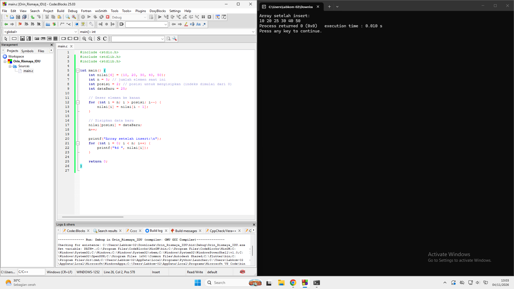
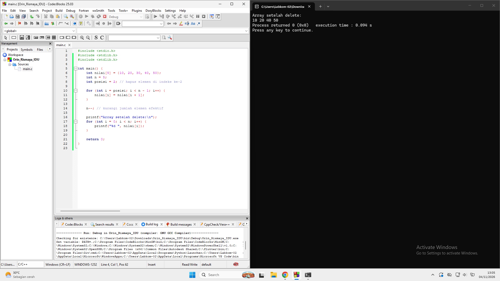

# OPERASI DASAR
## INSERT, DELETE, DAN UPDATE

### IDENTITAS MAHASISWA

- **Nama:** Orin Rismaya
- **NIM:** C2583207046
- **Mata Kuliah:** Algoritma dan Pemrograman Lanjut
- **Bahasa Pemrograman:** C
- **Software:** Code::Blocks

### 1. INSERT
Insert merupakan operasi untuk menambahkan data baru ke dalam array.

### 2. DELETE
Delete merupakan operasi untuk menghapus data pada posisi atau indeks tertentu di dalam array.

### 3. UPDATE
Update merupakan operasi untuk mengubah atau memperbarui nilai data yang sudah ada di dalam array.

---

## Kesimpulan
Dari praktikum ini, dapat dipahami tiga operasi dasar
dalam pemrograman bahasa C, yaitu:

1. Insert (Menambahkan Data)
2. Delete (Menghapus Data)
3. Update (Mengubah Data)

Program dibuat menggunakan bahasa C dengan aplikasi Code::Blocks.
